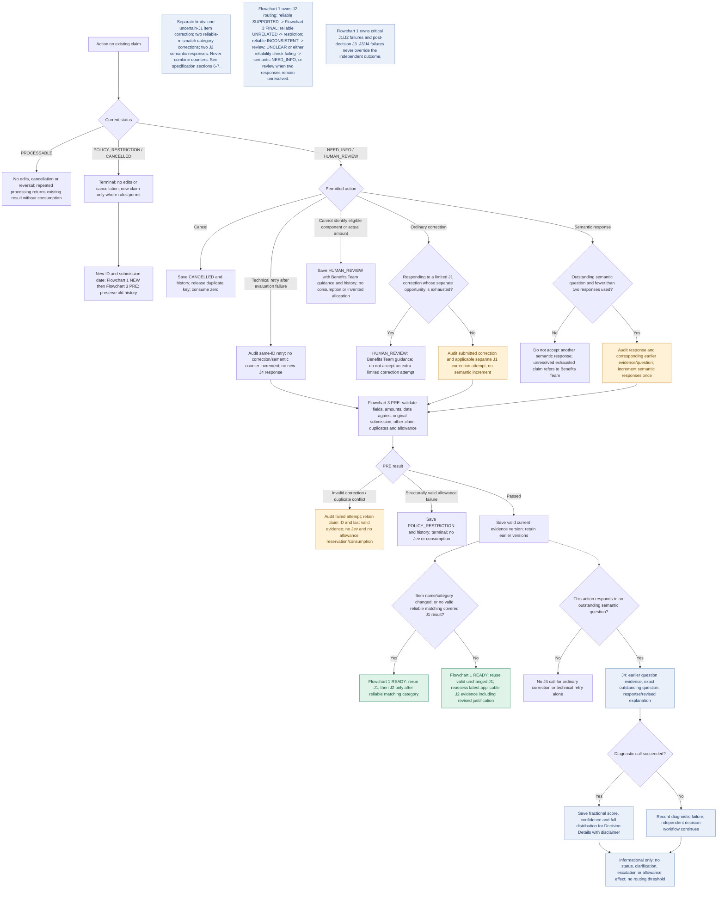
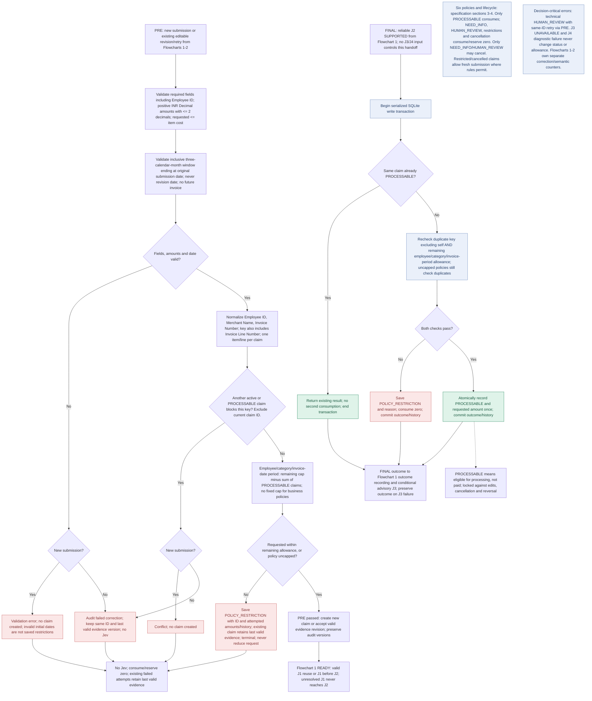

# Jev Expense Reimbursement — Consolidated Working Specification

**Status:** Current design reconciled on 2026-11-03 in Milestone 2 Phase B (documentation only; no application implementation). Sections 1–11 govern V1. Explicit recent finalized decisions and clearly dated later amendments take precedence over older agreed requirements, provisional recommendations, diagrams, and historical experiments, in that order. The README decision log records the approved resolutions consolidated here. Historical text is retained below for provenance, with superseded wording clearly scoped out of the current contract.

## 1. Scope — Finalized

A local-only educational reimbursement decision demo. A developer clones the repository, supplies their own API key in a local `.env`, runs FastAPI, and uses a basic HTML/CSS/JavaScript page and SQLite database. Jev inference calls use the configured remote API. No deployment, Docker requirement, OCR, PDF ingestion, authentication, Benefits Team portal, payments, actual invoice verification, or fraud determination. The interface supports submission, result, corrections, purpose clarification, revisions, cancellation, audit history, and an expandable Decision Details panel.

Each claim is for **one specific invoice line/item**. Manually entered invoice details are unverified employee statements. J1/J2/J3/J4 judgments are semantic assessments, not proof of honesty or payment eligibility.

## 2. Input contract — Finalized

Required: `employee_id`, `merchant_name`, `invoice_number`, `invoice_date`, `invoice_item_name`, `invoice_item_amount`, `reimbursement_category`, `requested_reimbursement`, `employee_justification`.

Optional: `invoice_line_number` (default `1`). The system generates `claim_id`, initial `submitted_at`, revision IDs/timestamps, and evaluation history. Use **Invoice Item Name**, not a generic free-form Invoice Description. An item name is nevertheless manually typed, so it is not independently verified.

All money is INR, positive, represented with Python `Decimal` and a maximum of two decimal places. `requested_reimbursement <= invoice_item_amount`. Users may request less than cost; no auto-adjustment of requested amount.

### Invoice date

On first submission, invoice date must be no later than the **initial submission date**, and no earlier than **three calendar months** before it, inclusive (not 90 days). Use the application’s chosen local business date consistently (India/Asia-Kolkata by default for this project; a clock should be injectable in tests). Example: submission 2026-10-31 accepts 2026-07-31, rejects 2026-07-30 and 2026-11-01. Revisions of a timely filed claim can occur after the three-month window, but **any corrected invoice date is always rechecked against the original submission date** (including the future-date bound). Preserve both the old and new dates. A date correction is not automatically proof of fraud.

## 3. Fictional reimbursement policies — Prior agreed rules, fully expanded

| Category | Allowance period and cap | Qualifying semantic scope |
|---|---|---|
| `WELLNESS` | ₹30,000 per employee, invoice calendar year | Employee's own personal fitness/wellbeing: running shoes, gym apparel/equipment, fitness wearables such as Garmin, headphones/AirPods for workouts, gyms/trainers, nonmedical meditation subscriptions. Broad audio products can be candidates based on invoice name, while **purpose** is assessed by J2. Excludes personal entertainment, fashion, and explicitly another person's use. Short clear explanation like “for daily running” is enough; “personal use” alone may be unclear. |
| `SMARTPHONE` | ₹100,000 per employee, invoice calendar year | Smartphone **handset**, for employee's own use; no work-use requirement. Tablets, watches, accessories, and services excluded. |
| `BROADBAND` | ₹3,000 per employee, invoice calendar month | Fixed home broadband/fiber connectivity; no requirement to prove working from home. Mobile hotspot/mobile-data products excluded. |
| `MOBILE_BILL` | ₹750 per employee, invoice calendar month | Prepaid/postpaid cellular voice/data. Complimentary bundled streaming does not itself disqualify the plan. **Separately charged streaming/entertainment extras are excluded**; do not reimburse those components. |
| `BUSINESS_HOTEL` | No fixed cap | Work-related overnight stays for client work, company internal training/offsites/workshops, etc. Explanation of the legitimate work purpose is enough; do not demand external proof. Location alone does not establish purpose. |
| `BUSINESS_TRANSPORT` | No fixed cap | Work-related journeys for client visits, client transport, internal training/offsites, or specific exceptional travel to the regular office required by a business event. **Ordinary daily home-to-regular-office commuting is excluded**. Merely going with colleagues or attending an unspecified event is insufficient. |

Categorization and purpose are deliberately distinct. A device can belong to a candidate category yet be used for an excluded purpose. A bundled/multi-line purchase must identify the particular claimed item and its actual cost; the system must not invent price allocation. Python validates the entered item amount and request, while J2 assesses applicable purpose evidence; neither verifies an underlying invoice.

### Mixed mobile bills — Finalized Q1

Keep the existing input contract: no itemization fields, new semantic classifier, or narrow policy-specific Noul gate. Use J1's existing reliable `MIXED_ITEMS` result where applicable to request an ordinary correction under the same editable claim ID: identify only the eligible cellular component and its actual charge, with requested reimbursement no greater than that charge. Do not calculate, infer or silently split the charges. This is not a semantic clarification attempt. If the component or its actual charge cannot be identified, refer to the Benefits Team (`HUMAN_REVIEW`). Complimentary streaming at no separate charge is not independently disqualifying.

The tested J1 V2 contract in `experiments/category_validation/v2_plan.json` already explicitly distinguishes combined separately charged mobile service plus Netflix (`MIXED_ITEMS`), a specifically claimed cellular line (`MOBILE_BILL`), and complimentary streaming (`MOBILE_BILL`). Its `MIXED_ITEMS` definition prohibits calculating reimbursement or assessing purpose. The historical V1 helper in `experiments/category_validation/experiment.py` lacks `MIXED_ITEMS`; do not substitute that obsolete definition for the V2 contract. Preserve both experiments unchanged. Detection from manually entered information is best-effort, with no guarantee of detecting mixed charges or verifying invoice authenticity. The current policy table governs any differences in historical candidate-policy wording.

## 4. Invoice-line identity and claim lifecycle — Finalized

Candidate duplicate key (scoped to employee): `(normalized_employee_id, normalized_merchant_name, normalized_invoice_number, invoice_line_number)`. Normalize case and incidental whitespace, but do not attempt unsupported fuzzy merchant identity. **An active or `PROCESSABLE` claim blocks a new claim on that line**. A `POLICY_RESTRICTION` or cancelled claim releases the key for a new initial submission, which must pass the three-month rule again. A processed line is never claimable a second time, even for the unpaid remainder. Revisions of the same claim ID do not self-conflict. Multiple different invoice lines under the same invoice are allowed.

### Editability and cancellation — Finalized Q2

| Status | Editing / retry behavior | Cancellation |
|---|---|---|
| `NEED_INFO` | Editable; ordinary corrections or response to the outstanding semantic question as applicable | Allowed; preserve history and release key |
| `HUMAN_REVIEW` | Permitted corrections and technical retries under the same ID | Allowed; preserve history and release key |
| `POLICY_RESTRICTION` | Terminal; cannot edit; a new claim may be submitted where rules permit | Not allowed |
| `CANCELLED` | Terminal; cannot edit; a new claim may be submitted where rules permit | No further cancellation |
| `PROCESSABLE` | Terminal for ordinary edits; no editing or reversal in V1 | Not allowed |

Restricted and cancelled claims remain in history. A new claim has its own ID and original submission date and must independently pass date and duplicate rules; resubmitting an excluded item does not make it eligible. An actual Benefits Team review workflow is not built in V1. `HUMAN_REVIEW` represents referral/intervention, not human processing or automatic approval.

### Revisions and evidence versions — Finalized Q3

Every revision has an auditable evidence version. Every submitted correction undergoes Python field, amount, original-submission-based date, duplicate and allowance validation again before decision-critical Jev evaluation. Exclude the current claim ID from duplicate comparison; changes to employee, merchant, invoice or line identity must still be checked against other claims. Preserve failed correction attempts and the last valid evidence version as described in §5.

- J1 uses the latest applicable Invoice Item Name and selected Reimbursement Category for the classification/comparison workflow, with candidate-category definitions. The selected category is compared against the classification; it must not force the answer. Employee justification is not category evidence. Rerun J1 when item name or category changes. Reuse a prior J1 result only if its relevant inputs are unchanged and that result remains valid. Reuse cannot bypass J1 routing: J2 still requires a reliable matching covered category, not merely a well-formed prior response.
- J2 uses the latest applicable item name, accepted category, justification and matching policy. Rerun after item/category changes once J1 is resolved, and after justification revisions; reevaluate other changed purpose evidence when applicable. Financial/identity/date changes always undergo Python validation; they do not become semantic evidence or force unrelated model calls.
- J3 uses raw employee-entered evidence and policy from the revision being evaluated, never J1/J2/J4 conclusions.
- J4 uses the outstanding semantic question, the corresponding earlier evidence, and the employee response/revised explanation.

Retain earlier versions, question revisions, model versions and evaluation input references in history. Here, raw evidence does not always mean the first submission: outdated evidence must not override a revised claim.

## 5. Python financial validation and allowance consumption — Finalized

1. **Before decision-critical Jev:** check required inputs, positive amounts with at most two decimal places, requested <= line price, original-submission-based invoice eligibility, duplicate claim key, selected-policy cap and already consumed amount. Apply the persistence table below. When requested > remaining allowance on a structurally valid claim, assign `POLICY_RESTRICTION` with a precise amount message; **do not** silently reduce it or call this semantic `NEED_INFO`. No fixed-cap comparison on uncapped business policies.
2. Only `PROCESSABLE` consumes allowance. `NEED_INFO`, `HUMAN_REVIEW`, cancelled, and `POLICY_RESTRICTION` consume/reserve zero. Annual/monthly allowance periods are keyed by **invoice date**, employee and policy.
3. **At final processing:** start a serialized SQLite write transaction, recognize an already processed same-claim request without consuming again, recheck the duplicate key (excluding this claim ID) and remaining applicable allowance, then atomically record `PROCESSABLE` and the consumed requested amount. If the final duplicate or allowance recheck fails, save `POLICY_RESTRICTION` with no consumption. Processing and retries are idempotent: repeated evaluation/request cannot consume twice. For V1, derive consumed balance as sum of `PROCESSABLE` claims instead of maintaining a second mutable balance column.
4. Financial checks are deterministic; none of the Jev questions perform arithmetic or authorize payment.

### Validation outcomes and persistence — Finalized Q4

| Request / failure | Response and persistence | Jev / allowance |
|---|---|---|
| New submission: missing/malformed required fields, nonpositive amount, too many decimal places, requested > item amount, future or too-old invoice date | Validation error; do not create a claim | No Jev; no consumption/reservation |
| New submission: invoice line blocked by an active or `PROCESSABLE` claim | Conflict; do not create a claim | No Jev; no consumption/reservation |
| Structurally valid, nonconflicting new claim exceeds remaining allowance | Save `POLICY_RESTRICTION` with claim ID and history | No decision-critical Jev; no consumption/reservation |
| Structurally valid claim is semantically ineligible | Save `POLICY_RESTRICTION` with claim ID and history | Skip downstream calls when prerequisites fail; no consumption/reservation |
| Existing editable claim: invalid field/amount/date correction or duplicate conflict | Preserve claim ID and last valid evidence; audit failed correction and precise validation/conflict reason; do not replace last valid version | No Jev on failed deterministic validation; no consumption/reservation |
| Structurally valid revision exceeds remaining allowance | Save `POLICY_RESTRICTION` under the existing ID, audit the attempted values and allowance reason, and preserve the last valid evidence version; terminal per §4 | No Jev; no consumption/reservation |

For revisions, corrected dates must lie in the inclusive three-calendar-month window ending on the **original submission date**, including its future-date bound. An invalid date correction is a failed correction, not a policy-restricted replacement of the last valid evidence. A valid revision records the new evidence version before applicable evaluation. A policy allowance failure is distinct from malformed input and must not be disguised as a field-validation error.

## 6. Jev questions — Finalized responsibilities

### J1 — Choice: invoice-item category

Use the current evidence/version rules in §4. Classify item identity from Invoice Item Name and candidate-category definitions, not the employee's justification. Outputs six covered categories plus `OTHER`, `INSUFFICIENT_INFORMATION`, `MIXED_ITEMS`, with full Choice distribution/confidence. Python validation precedes J1; J1 must resolve before J2.

First validate the response: a missing/malformed response or missing required fields is a **technical failure**, not `INSUFFICIENT_INFORMATION`. Then apply confidence and top-two margin checks before trusting any label.

| Valid J1 response | Outcome; J2 prerequisite |
|---|---|
| Either reliability check fails | `NEED_INFO` requesting more precise item name; one uncertain-classification correction opportunity, then `HUMAN_REVIEW` if still unresolved; no J2 |
| Reliable covered category matches employee selection | Proceed to J2 |
| Reliable covered category mismatches selection | `NEED_INFO` for category correction before J2; never silently change category. Allow at most two ordinary category-correction attempts after a reliable mismatch; if still mismatched after the second, `HUMAN_REVIEW` |
| Reliable `OTHER` | `POLICY_RESTRICTION`; skip J2 |
| Reliable `INSUFFICIENT_INFORMATION` | Ask for a specific item name; rerun J1 after correction; no J2 until resolved |
| Reliable `MIXED_ITEMS` | Ask for one identifiable item and its actual corresponding amount, including mobile component correction in §3; rerun J1; no J2 until resolved |
| Eligible component or actual amount cannot be identified / inseparable bundle | `HUMAN_REVIEW` with Benefits Team guidance; no invented allocation |

The category-correction limit (finalized Q5), uncertain-classification correction opportunity, and J2 semantic-response limit are separate counters (§7). Ordinary corrections do not consume semantic attempts. A category change may produce the same J1 classification; do not force a different label.

### J2 — Choice: purpose alignment

Runs only after J1 establishes a reliable, employee-matching covered category. Use the latest applicable item name, accepted category, employee justification/purpose evidence, and matching policy (§4). Do not use financial balance or other Jev judgments as evidence. Malformed/missing responses use the critical-failure rule in §7.

| J2 label | Confidence and top-two margin both pass | Either check fails |
|---|---|---|
| `SUPPORTED` | Continue to final atomic duplicate-and-allowance checks | Semantic `NEED_INFO` |
| `UNRELATED` | `POLICY_RESTRICTION` | Semantic `NEED_INFO` |
| `INCONSISTENT` | `HUMAN_REVIEW` with Benefits Team guidance | Semantic `NEED_INFO` |
| `UNCLEAR` | Semantic `NEED_INFO` | Semantic `NEED_INFO` |

Every semantic `NEED_INFO` applies the two-response limit in §7; unresolved after the second response becomes `HUMAN_REVIEW`. A resolved second response follows its resolved outcome. Explicit `UNCLEAR` never becomes `PROCESSABLE`, even with high confidence. `INCONSISTENT` is possible item-purpose mismatch, not proof or accusation of dishonesty or fraud.

### Confidence/margin — Experimental default configuration

Use `JEV_MIN_CONFIDENCE=0.70`, `JEV_MIN_PROBABILITY_MARGIN=0.30` from environment/backend settings, not hardcoded in each branch. Margin = highest Choice label probability minus second-highest. **Both** checks are used, and confidence is **not** interchangeable with winning-label probability. Treat defaults as provisional, not proven calibrated thresholds. Preserve complete distributions, chosen label, reported confidence, model version, and question revision in decision history. If the SDK response lacks required fields or is malformed, fail safely (see errors).

### J4 — Score: clarification-resolution assessment

Only on employee responses to an **outstanding semantic clarification question**; compare the corresponding earlier evidence, exact question, and employee response/revised explanation (§4). Rubric: `0` no relevant resolution, `1` partial resolution, `2` fully answered. Score is fractional in [0,2], with rubric-level probabilities and separate confidence. Save score, confidence and the complete probability distribution in the evaluation history and make them available in Decision Details.

J4 is **informational only**. It cannot influence claim status, approval, rejection, clarification, escalation or allowance consumption; **no J4 routing threshold exists**. Every revision independently undergoes Python validation and relevant J1/J2 evaluation. Do not call Jev, including J4, when deterministic validation fails; retain the response/question evidence in the failed-attempt audit instead. When validation permits evaluation, J4 runs as an independent diagnostic for the semantic response. On J4 failure record a diagnostic failure and continue the decision workflow. A fully answered question can reveal an excluded purpose; high Score is not approval. Display: “This score indicates how completely the clarification question was answered; it does not determine reimbursement eligibility or the final decision.”

### J3 — Noul: advisory-only semantic comparison

After Python determines a claim outcome, provided the required J1 and J2 evaluations completed successfully for the evidence being evaluated (including valid applicable J1 reuse), run one Noul proposition about whether **the raw current-revision claim evidence affirmatively supports the qualifying semantic requirements of the selected policy**. Supply employee-entered evidence and policy, **not the conclusions of J1/J2/J4**. Record proposition probability and supported response metadata, model/question version and evidence version; do **not** call it a likelihood that the final decision is correct. It performs no monetary calculation or verification and cannot approve, deny, clarify, escalate, consume allowance or change status. A J3 failure is `UNAVAILABLE` and preserves the decision. Prior narrow Noul tests (exceptional commute, charged mobile extras) stay in `experiments/` and **are not V1 calls**.

J3 may follow semantic `NEED_INFO`, semantic `HUMAN_REVIEW`, semantic restriction, final financial restriction or `PROCESSABLE` when both prerequisites succeeded. Skip it after failed or skipped required J1/J2, including J1-only restrictions/corrections and pre-evaluation deterministic failures.

**Ordering note:** J3 is diagnostic *after* the Python decision. The UI should not present the decision as waiting for advisory Noul. If synchronous evaluation runs J3 before returning HTTP response for simplicity, a timeout must still never turn a processable decision into review.

## 7. Clarification and error handling — Finalized

One **broad, predefined question per category**, mapped directly from category in Python. No separate Choice call to select clarification type and no free-text generation. Deterministic input errors have precise messages. Example Business Transport: “Please explain the business purpose of your journey and why the travel was necessary.” Wellness: “Please explain how this purchase supports your personal fitness or wellbeing.” No mandatory essay or external verification.

A semantic `NEED_INFO` creates an outstanding question. Each submitted response increments the semantic clarification count **once**. If still uncertain and the count <2, ask again. After count 2 with unresolved semantic interpretation, route to `HUMAN_REVIEW` with “Please get in touch with the Benefits Team.” The `NEED_INFO` status for item name/category/mixed-line correction is distinguished internally by a **reason code** so that field correction does not consume semantic attempts.

| Counter | Separate limit and purpose |
|---|---|
| Uncertain J1 item-classification correction | One correction opportunity; if classification remains unresolved afterwards, Benefits Team referral |
| Reliable J1 category-mismatch correction | Maximum two ordinary category-correction attempts after a reliable mismatch; still mismatched after the second → `HUMAN_REVIEW` |
| J2 semantic clarification response | Maximum two responses to an outstanding semantic question; unresolved after the second → `HUMAN_REVIEW` |

Do not combine or substitute these counters. Ordinary item/category/component corrections and technical retries do not consume semantic responses. Audit action type, applicable attempt and outcome; retries do not count a response twice. Save and validate revisions per §§4–5 before decision-critical evaluation. J4 runs only for a semantic response and independently of the decision path; ordinary corrections and technical retries alone do not trigger J4.

Decision-critical Jev timeout, invalid/missing response, or provider error → `HUMAN_REVIEW` with a technical-failure reason, no allowance consumption; users may **retry same claim ID**, with each attempt recorded and no clarification-count increment. J3 advisory errors do not affect claim status. No secrets in audit logs. A hypothetical payment is never made by this demo.

| Evaluation failure | Result |
|---|---|
| Required J1 or J2 | Technical `HUMAN_REVIEW`, Benefits Team guidance, no consumption; allow auditable same-ID retry through Python validation |
| Advisory J3 | `UNAVAILABLE` diagnostic; preserve decided outcome and consumption |
| Informational J4 | Diagnostic failure; continue independent Python/J1/J2 workflow without status or consumption impact from J4 |

## 8. Status transitions and persistence — Consolidated

| Current state | Trigger | Next state / behavior |
|---|---|---|
| New submission | Invalid fields/amount/date, or blocked duplicate | Validation error or conflict; no claim created (§5) |
| New or editable claim | Structurally valid allowance failure | Save `POLICY_RESTRICTION`; terminal; no consumption |
| Editable claim | Invalid correction / conflicting revised identity | Audit failed correction; keep claim ID and last valid evidence; no Jev or consumption |
| Validated claim | Valid but uncertain J1 / insufficient information / mixed / category mismatch | `NEED_INFO` (`FIELD_CORRECTION`) or review at the applicable separate limit; no J2 until resolved |
| Validated claim | Reliable J1 OTHER | Save `POLICY_RESTRICTION`; no J2 |
| Valid category | J2 uncertain or UNCLEAR | `NEED_INFO` (reason `SEMANTIC_CLARIFICATION`); ask broad template |
| Valid category | Confident J2 UNRELATED | `POLICY_RESTRICTION` |
| Valid category | Confident J2 INCONSISTENT | `HUMAN_REVIEW` |
| Valid category | Confident J2 SUPPORTED + final transaction valid | `PROCESSABLE` and consume allowance once |
| Semantic NEED_INFO | Clarification submitted | Audit response/count once; validate Python; applicable J1/J2; J4 diagnostic only; route fresh outcome |
| Semantic NEED_INFO | Second response still unresolved | `HUMAN_REVIEW`; Benefits Team message |
| Critical Jev failure | Any critical call | `HUMAN_REVIEW` (reason `TECHNICAL_FAILURE`); allow same-claim retry |
| NEED_INFO / HUMAN_REVIEW | Cancellation | `CANCELLED`; release key; no allowance consumed |
| POLICY_RESTRICTION / CANCELLED | New claim | New claim ID, validate invoice age afresh, preserve old history |
| POLICY_RESTRICTION / CANCELLED | Same-ID edit | Disallow; terminal |
| PROCESSABLE | Edits/cancellation/new claim on same line | Disallow in V1 |
| PROCESSABLE | Repeated processing request for same claim | Idempotent existing result; no second consumption |

Suggested *minimal* SQLite data: `claims` (identity/current status/original submitted timestamp/separate correction and semantic counts), `claim_revisions` (submitted input snapshot, validity/failed-attempt record, revision reason and timestamp, last valid evidence reference), `evaluations` (question type, evidence/input version, model version, label, full distribution, confidence/score/Noul probability, failure metadata), `status_events` (from/to, reason, timestamp). Exact schema and indexes can be selected during implementation while maintaining unique active/processed invoice-line behavior, transactionality, and auditability. Do not store API keys.

## 9. Local UI and reproducibility

One basic claim form, a claims/history view, and an expandable developer decision panel. Support only the edits/cancellations permitted by §4, entering clarification answers, and retrying technical failures. Show status and plain-language reason, not a fraud accusation or a “paid” claim; `PROCESSABLE` means eligible for processing, not paid or actual payment approval. Developer panel shows full Jev distributions/confidence, J4 score/confidence/rubric probabilities and disclaimer, J3 diagnostic probability when available, and diagnostic failures. Examples in the eventual application README should include correct Wellness running use, unrelated gift/movie purpose, wrong category Garmin, unclassified iPad, vague business journey, exceptional client meeting, mobile complimentary vs charged streaming, partially answered clarification, invalid old invoice, insufficient balance, and duplicate line. Results may vary with model versions; each developer supplies their own API key and all UI/SQLite run locally.

Preserve historical J1/J2/J3/J4 experiments and pre-registered fixtures as evidence; do not overwrite experimental data or falsely label Noul as an accuracy probability.

## 10. Flowcharts — Current Mermaid sources

The three embedded blocks below match `flowchart/Flowchart_1.txt`, `Flowchart_2.txt`, and `Flowchart_3.txt` respectively. `PRE`, `READY` and `FINAL` are named handoffs, not instructions to restart the entire evaluation. Flowchart 1 owns J1/J2 routing and conditional post-decision J3; Flowchart 2 owns permitted actions and informational J4; Flowchart 3 owns deterministic validation and the final transaction. Reference tables in §§3–8 govern details omitted for readability. See the README's Flowcharts note for source and image maintenance.

### Main claim evaluation

```mermaid
flowchart TD
    New["New submission"] --> Pre["Flowchart 3 PRE: Python fields, amounts, original-date window, duplicate and allowance checks"]
    Pre --> PreResult{"PRE passed?"}
    PreResult -->|No| PreStop["PRE handles error/conflict with no new claim, or saves allowance restriction; no Jev"]
    PreResult -->|Yes| Ready["READY: validated evidence version; revision/retry enters here from Flowchart 2"]
    Ready --> Reuse{"Unchanged J1 inputs and valid reliable matching covered J1 result?"}
    Reuse -->|Yes| Purpose["J2: latest applicable item, matching category, justification and policy"]
    Reuse -->|No| Category["J1: latest item identity and candidate definitions; compare selected category; no justification"]
    Category --> CategoryValid{"J1 response valid and complete?"}
    CategoryValid -->|No / API failure| Technical["HUMAN_REVIEW: technical failure; no consumption; same-ID retry via Flowchart 2"]
    CategoryValid -->|Yes| CategoryReliable{"J1 confidence and top-two margin both pass?"}
    CategoryReliable -->|No| ItemLimit{"Uncertain-item correction already used?"}
    ItemLimit -->|Yes| Review["HUMAN_REVIEW: Benefits Team referral; no actual review workflow"]
    ItemLimit -->|No| ItemInfo["NEED_INFO FIELD_CORRECTION: precise item name; one uncertain-item correction opportunity"]
    CategoryReliable -->|Yes| CategoryLabel{"Reliable J1 label"}
    CategoryLabel -->|OTHER| Restricted["POLICY_RESTRICTION: saved terminal claim; no consumption"]
    CategoryLabel -->|INSUFFICIENT_INFORMATION| Specific["NEED_INFO FIELD_CORRECTION: specify item name"]
    CategoryLabel -->|MIXED_ITEMS| Mixed["NEED_INFO FIELD_CORRECTION: one eligible item and actual amount; includes separately charged mobile extras; never infer split"]
    CategoryLabel -->|Covered category| Matches{"Matches employee category?"}
    Matches -->|Yes| Purpose
    Matches -->|No| CategoryLimit{"Two category-correction attempts already used?"}
    CategoryLimit -->|Yes| Review
    CategoryLimit -->|No| CategoryInfo["NEED_INFO FIELD_CORRECTION: employee corrects category; never change silently"]
    Purpose --> PurposeValid{"J2 response valid and complete?"}
    PurposeValid -->|No / API failure| Technical
    PurposeValid -->|Yes| PurposeLabel{"J2 label"}
    PurposeLabel -->|UNCLEAR at any confidence| Unresolved{"Two semantic responses already used?"}
    PurposeLabel -->|SUPPORTED / UNRELATED / INCONSISTENT| PurposeReliable{"J2 confidence and top-two margin both pass?"}
    PurposeReliable -->|No| Unresolved
    PurposeReliable -->|Yes| ReliablePurpose{"Reliable J2 label"}
    ReliablePurpose -->|SUPPORTED| Final["Flowchart 3 FINAL: serialized SQLite transaction; idempotent duplicate-and-allowance recheck"]
    ReliablePurpose -->|UNRELATED| Restricted
    ReliablePurpose -->|INCONSISTENT| Review
    Unresolved -->|Yes| Review
    Unresolved -->|No| SemanticInfo["NEED_INFO SEMANTIC_CLARIFICATION: predefined category question"]
    Final --> FinalResult{"FINAL outcome"}
    FinalResult -->|Duplicate or allowance failure| Restricted
    FinalResult -->|Committed / already processed same claim| Processable["PROCESSABLE recorded once; eligible for processing, not paid"]
    ItemInfo --> Record["Record outcome and evidence/evaluation versions; only PROCESSABLE consumes allowance"]
    Specific --> Record
    Mixed --> Record
    CategoryInfo --> Record
    SemanticInfo --> Record
    Restricted --> Record
    Review --> Record
    Technical --> Record
    Processable --> Record
    Record -.-> Actions["Actions use Flowchart 2 editability table; terminal claims cannot edit; only NEED_INFO/HUMAN_REVIEW can cancel"]
    Record --> AdvisoryEligible{"Required J1 and J2 succeeded for this evidence version, including valid J1 reuse?"}
    AdvisoryEligible -->|No| Unchanged["Preserve outcome and allowance; diagnostics never route claims"]
    AdvisoryEligible -->|Yes| Noul["J3: one advisory semantic-support proposition using raw current-revision evidence and policy; no other judgments or arithmetic"]
    Noul --> AdvisoryResult{"Advisory call succeeded?"}
    AdvisoryResult -->|Yes| Probability["Save proposition probability and supported metadata for Decision Details"]
    AdvisoryResult -->|No| Unavailable["Record UNAVAILABLE diagnostic"]
    Probability --> Unchanged
    Unavailable --> Unchanged
    Defaults["Both Choice checks: configurable confidence >= 0.70 and margin >= 0.30; provisional, not calibrated. J4 only in Flowchart 2; no routing threshold."]

    classDef success fill:#DFF3E9,stroke:#22865B,color:#18593F
    classDef warning fill:#FFF1D6,stroke:#BC872D,color:#704F11
    classDef neutral fill:#EAF0FA,stroke:#6686BB,color:#233C65
    class Processable success
    class ItemInfo,Specific,Mixed,CategoryInfo,SemanticInfo warning
    class Noul,Probability,Unavailable,Unchanged,Defaults neutral
```

### Revision and clarification

### Financial integrity

## 11. Resolution record and limitations

The five Phase A questions are finalized in this current contract: Q1 mixed mobile bills (§3), Q2 editability (§4), Q3 evidence versions (§4), Q4 invalid submissions/persistence (§5), and Q5 category-correction limit (§§6–7). The earlier J4-routing, uncertain-INCONSISTENT and revision-validation discrepancies are resolved in §§4–7. These are no longer open policy choices.

Known limitations remain: omitted line numbers default to `1` and can collide for distinct items on the same invoice; encourage actual line numbers for multi-line invoices. Normalized manual identifiers do not prove uniqueness. Mixed-item detection is best-effort (§3), not verified bill auditing. Choice thresholds are configurable experimental defaults, not calibrated accuracy guarantees. None of these limitations authorizes adding new classifiers, invoice inspection or infrastructure.

No unresolved contradiction in the five approved decisions remains. Exact code/schema choices belong to later milestones; this phase implements no behavior. Any newly discovered ambiguity must be surfaced before implementing that branch rather than resolved by historical experiments or diagram shorthand.

---

## Historical specification and amendments — provenance only

The retained text below includes the earlier specification and later dated amendments, reproduced without rewriting their original claims. All still-current decisions, including Steps 37–39, have been consolidated into §§1–11 above. This historical section is not a competing implementation contract. Its old headings such as “Finalized,” “Preliminary,” “Next work,” and “not yet synchronized” describe their original context, not present project status.

**Supersession map:** historical Step 12's broad pre-PROCESSABLE editability is restricted by current §4/Q2; Step 13's invalid-date `POLICY_RESTRICTION` is superseded by §5/Q4's validation/failed-correction rules; Step 14's generic API-failure rule applies only to decision-critical J1/J2 under §7, not J3/J4 diagnostics. Historical “original” evidence means the applicable evaluated version under §4/Q3, not necessarily the first submission. Historical Steps 26–29 are supplemented by the distinct correction limits in §§6–7/Q5. Step 39 is implemented in the design through the existing J1 V2 `MIXED_ITEMS` contract (§3/Q1), with no new itemization fields or classifier. The current six-policy table (§3), J2 routing table (§6), and advisory-only J3/J4 rules (§6) supersede any older provisional alternatives. Historical experimental observations remain observations, not new policy or calibrated guarantees.

# Jev Expense Reimbursement — Working Design Specification

Status: living draft. Updated 2026-11-02. Decisions marked **Finalized** are agreed; **Proposed** items require discussion.

## Project boundaries — Finalized
- Local-only developer demo: clone repository, configure own API key, run FastAPI and basic local HTML/JS UI with SQLite. Remote Jev inference uses developer-provided key. No hosting, OCR, invoice PDF ingestion, authentication, Docker requirement, or Benefits Team integration.
- One claim covers one specific manually entered invoice item/service. Several distinct claims may share an invoice.
- UI shows result, actionable clarification when needed, revision history and optional developer decision details. Unresolved uncertainty directs employee to Benefits Team.
- J1 Choice: product/service category. J2 Choice: purpose alignment. J3 Noul: advisory-only semantic cross-check after decision-critical J1/J2; never influences routing. J4 Score: degree to which revision answers clarification (experimental results encouraging). Python owns validation, financial arithmetic and routing. Model confidence and distributions are preserved and evaluated; initial experimental confidence >= 0.70 and margin >= 0.30.

## Submission fields — Finalized
1. **Employee ID** (required; manually entered, no authentication or registration; identifies separate local claim and allowance histories)
2. **Merchant Name** (required; manually entered)
3. Invoice number (required)
4. Invoice date (required)
5. Invoice line number (optional; default 1; used for invoice-line identity and duplicate prevention)
6. **Invoice Item Name** (required, rather than free-form `description`; user-entered representation of invoice name, not independently verified)
7. Invoice Item Amount in INR (required)
8. Reimbursement Category (required, selected by employee)
9. Requested Reimbursement in INR (required)
10. Employee Justification (required)
System generates claim ID; revisions retain claim ID and audit history. It does not silently change selected category.

## Invoice age validation — Finalized
- At initial submission, invoice date must not be in the future and must be no older than **three calendar months** from submission's local current date, inclusive; not a fixed 90-day approximation.
- E.g. on 2026-10-31, 2026-07-31 is eligible, 2026-07-30 is too old; 2026-11-01 is future-dated.
- Invalid date is rejected before Jev inference.
- Annual/monthly allowance attribution uses the invoice's calendar year/month, not the submission date.
- **Revision-age rule — Finalized:** validate the three-month age limit only at the initial submission. Timely submitted claims may be revised after the invoice passes the three-month cutoff, retaining the same claim ID. Future dates and other field checks still apply to submitted revisions; do not create a new claim to bypass the date rule.

## Amount and duplicate-claim rules — Finalized (2026-10-31)
- Invoice item amount and requested reimbursement are positive INR Decimal quantities, maximum two decimal places.
- Requested reimbursement must not exceed the invoice item amount. An employee may request less, and Python must not automatically raise the requested amount.
- Python enforces the remaining allowance for the applicable policy period. **Finalized Step 9:** if the requested reimbursement exceeds the remaining allowance, reject that claim as `POLICY_RESTRICTION` with the requested amount and remaining balance in the explanation; do not return `NEED_INFO` merely to request amount correction and do not silently reduce the amount. Business Hotel/Business Transport have no fixed allowance cap. If a claim is rejected specifically because its requested reimbursement exceeds remaining allowance, the employee may submit a **new claim** for the same invoice line at a lower requested amount, provided the new claim meets the three-calendar-month invoice-age limit at its own initial submission. The original rejected claim stays in history and consumes no allowance. This rejection releases the duplicate key for a corrected new claim. **Finalized Step 11:** a `POLICY_RESTRICTION` for any policy reason likewise releases the duplicate key and permits a new claim for the same invoice line, provided all new-submission validations (including invoice age) pass. Rejected claims remain in history and consume no allowance. An ineligible purchase does not become eligible merely by resubmission.
- One invoice line may be reimbursed only once: after a line has been processed, a second claim on that same line (even for an unused remainder of the price) is not accepted.
- A claim can be revised under the same claim ID before processing; revisions are not independent new reimbursements and must not double-count allowance.
- **Merchant-name identity — Finalized:** merchant name is required to distinguish invoice numbers issued by different merchants. For the local demo, use employee ID + normalized merchant name + normalized invoice number + invoice line number as the candidate duplicate key. Manually typed merchant names can vary; this is not independently verified identity and is not fraud detection.
- **Pending duplicate claims — Finalized:** while an active claim exists for the same employee + normalized merchant + invoice + line key, block creating another claim for that line; direct the employee to revise the existing claim. Processed lines remain blocked. Cancelled claims release the key; **all policy-rejected claims also release the key for a new submission**. New submissions must satisfy the invoice-age rule.

## Allowance consumption — Finalized (2026-10-31)
- Only a claim reaching `PROCESSABLE` consumes its requested reimbursement amount from the applicable policy period. `NEED_INFO`, `HUMAN_REVIEW`, and `POLICY_RESTRICTION` do not consume or reserve any allowance.
- `PROCESSABLE` means eligible for processing in this demo, not actual payment approval.
- Processing/retries/revisions must not double-deduct; enforce the balance check and recording of consumption atomically in SQLite to avoid competing claims overdrawing a balance.
- Reversal of a processed claim is outside V1.

## Employee identity — Finalized (2026-10-31)
- Require an Employee ID on claims. Each employee ID has its own allowance balances and claim history. No signup, passwords or authentication; this is a local learning demo.
- Duplicate checks are scoped to the same Employee ID; separate employees are not automatically flagged as duplicates solely because their merchant/invoice/line key matches.

## Revision editing — Finalized (Step 12, 2026-10-31)
- Before a claim reaches `PROCESSABLE`, employees may correct invoice details (including invoice number), while retaining its claim ID.
- Every edit creates an auditable revision; Python reruns validation and duplicate checks against the revised identity/values, excluding the current claim's own ID from the duplicate comparison.
- Once `PROCESSABLE`, invoice details are locked; no V1 editing/reversal of processed claims.
## Invoice-date corrections — Finalized (Step 13, 2026-10-31)
- If a revision changes the invoice date, validate that corrected date against the claim's **original submission date**, not the revision date.
- If the corrected date was older than three calendar months at original submission, or was future-dated then, it fails eligibility validation and routes to `POLICY_RESTRICTION`.
- Preserve original and corrected dates in the audit history. A discrepancy is not automatically fraud; manual invoice data cannot establish intent or authenticity. Material indications of misrepresentation may be flagged for Benefits Team review without making an accusation.

## Jev API errors and retries — Finalized (Step 14, 2026-10-31)
- Timeouts, malformed responses, and API failures must **never** lead to `PROCESSABLE` or allowance consumption.
- Record the claim as `HUMAN_REVIEW` with a technical evaluation failure reason; show a friendly message advising the employee to contact the Benefits Team.
- Permit the employee to **retry evaluation on the same claim ID** after a technical error; record each attempt and outcome in audit history and preserve safe failure diagnostics without storing or exposing API keys.
- Do not deduct allowance on failed attempts; protect against duplicate consumption if a subsequent retry succeeds.

## Clarification lifecycle — Finalized (Step 15, 2026-10-31)
- Allow at most **two semantic clarification responses** per claim. Each response to an explicit outstanding clarification counts as one attempt, and is auditable.
- After each clarification response, J4 Score evaluates how completely the response addresses the specific question, and relevant semantic decisions are re-evaluated on the revised claim. A sufficiently answered question never by itself means reimbursement eligibility.
- If semantic uncertainty remains unresolved after two clarification responses, route to `HUMAN_REVIEW` and direct the employee to the Benefits Team.
- Technical retries for Jev failures and ordinary edits/corrections not submitted as answers to an outstanding semantic question do **not** count as clarification attempts.
- Do not treat a high Score as authorization to process or a low Score as evidence of dishonest intent.

## Next work
- Settle remaining claim-routing and lifecycle decisions one at a time; then draw three flowcharts and prepare the Codex implementation specification.

## Preliminary policies (from prior design, for later confirmation)
- Wellness: INR 30,000 / calendar year.
- Smartphone handset: INR 100,000 / calendar year.
- Fixed home broadband: INR 3,000 / month.
- Cellular mobile bill: INR 750 / month, excluding separately charged entertainment extras.
- Business hotel and qualifying business transport: no fixed caps; ordinary home-to-regular-office commute excluded except specific qualifying business exceptions.

This spec records agreements from the design discussion; it is **not yet synchronized to the GitHub repository**.

## Semantic workflow decisions — Steps 16–25 (finalized)
- **Step 16 — Clarification questions:** Use one broad, predefined clarification template per reimbursement category, chosen by Python. No extra Jev call. Deterministic validation errors get direct messages.
- **Steps 17–19 — Choice uncertainty:** Inspect both Jev reported confidence and difference between two leading Choice probabilities. Experimental defaults: confidence >= 0.70 and margin >= 0.30; not calibrated. Low-confidence/marginal SUPPORTED or UNRELATED => NEED_INFO; if uncertainty persists after two clarification responses, HUMAN_REVIEW. Preserve distributions and confidence.
- **Steps 20–23 — J3 Noul:** One advisory-only semantic-support proposition given claim evidence and policy, not earlier model outputs. Run after Python decides, where J1 and J2 complete successfully, regardless of status. Never change outcome; failure recorded UNAVAILABLE only. Previous narrow commute/mobile Noul tests remain in experiments, not application V1.
- **Step 24 — J4 Score:** On clarification revisions, evaluate completeness of the response to the exact question. Rerun relevant J2/policy decisions regardless. J2 and Python control all routing, including when unresolved; Score is displayed for educational/diagnostic purposes and never independently influences approval, rejection, clarification or escalation.
- **Step 25 — J1 revision policy:** Rerun J1 when Invoice Item Name or selected Category changes; reuse J1 if only justification changes. J2 reassesses revised justification; retain audit history.

## Step 26 — Category correction ordering (finalized, 2026-11-02)
- J1 checks invoice item category first. On reliable mismatch with employee-selected category, pause and ask correction **before J2**. Correction under same claim ID, rerun J1, then J2 if category matches; ordinary category correction doesn't consume a semantic clarification attempt. If J1 itself uncertain, use uncertainty routing rather than claim definitive mismatch.

## Step 27 — Uncertain J1 classification (finalized, 2026-11-02)
- If J1's selected category fails the agreed provisional confidence or probability-margin checks, do **not** proceed to J2 or assert a definitive category mismatch.
- Return `NEED_INFO` requesting a more specific **Invoice Item Name**; the correction is an ordinary field edit and does **not** count against the two semantic-purpose clarification attempts.
- Rerun J1 after the item name is corrected. If classification is still unresolved, send the claim to `HUMAN_REVIEW` with Benefits Team guidance, rather than looping indefinitely.
- Keep original and corrected item names, J1 confidence and complete distributions in the audit history.

## Step 28 — J1 returns OTHER (finalized, 2026-11-02)
- When J1 confidently returns `OTHER`, the item does not fit any covered category: route to `POLICY_RESTRICTION` without calling J2.
- Explain to the employee that the item is not covered by the reimbursement policies; preserve the claim and decision in history.
- This differs from a mismatch with another *covered* category, which is correctable before J2.
- Existing decisions on resubmitting rejected claims and on confidence-aware handling still apply.

## Document maintenance
- This filename is the single authoritative working specification in this conversation. Update this file in place at decision checkpoints rather than creating V2/V3/V4 copies. Earlier versions are superseded.

## Step 29 — J1 returns INSUFFICIENT_INFORMATION or MIXED_ITEMS (finalized, 2026-11-02)
- `INSUFFICIENT_INFORMATION`: return `NEED_INFO` asking for a more specific **Invoice Item Name**; do not call J2 yet.
- `MIXED_ITEMS`: return `NEED_INFO` asking the employee to identify the single claimed invoice item and its actual corresponding amount; do not call J2 yet.
- Corrections stay under the same claim ID, preserve audit history, rerun J1, and do not use either of the two semantic-purpose clarification attempts.
- If the invoice contains a genuinely inseparable bundle or its component price cannot be established, do not invent or prorate amounts: route unresolved cases to `HUMAN_REVIEW` with Benefits Team guidance.
- Apply the existing J1 confidence/uncertainty policy before treating these classifications as definitive.

## Step 30 — J2 INCONSISTENT (finalized, 2026-11-02)
- `INCONSISTENT` denotes a potentially qualifying stated purpose materially at odds with the purchased item/service. It is distinct from `UNRELATED`, where the stated purpose itself is explicitly excluded.
- Following J1 category validation, route a confident J2 `INCONSISTENT` result to `HUMAN_REVIEW` with Benefits Team guidance, not a fraud accusation or automatic policy denial.
- Preserve the submitted evidence and Jev response in audit history. Handle uncertain J2 results under the existing confidence-aware routing principles; do not treat model judgments as proof of dishonesty.

## Step 31 — J2 UNCLEAR (finalized, 2026-11-02)
- Route J2 `UNCLEAR` to `NEED_INFO`, using the broad category-specific clarification template.
- Allow at most two semantic clarification responses; if still unresolved, route to `HUMAN_REVIEW` with Benefits Team guidance.

## Step 32 — J2 SUPPORTED and configurable uncertainty thresholds (finalized, 2026-11-02)
- J2 `SUPPORTED` proceeds only when reported Choice confidence and top-two probability margin pass the configured safeguards; otherwise route to `NEED_INFO`, subject to the agreed two-attempt limit.
- Initial experimental defaults: `JEV_MIN_CONFIDENCE=0.70` and `JEV_MIN_PROBABILITY_MARGIN=0.30`; read from local backend environment/configuration, not hardcoded throughout routing. Values are provisional and not calibrated.
- If semantic checks and deterministic financial validations pass, set `PROCESSABLE` and atomically consume the applicable allowance, with no double deduction on revision/retry.
- Advisory J3 Noul runs after the Python outcome if decision-critical J1 and J2 completed successfully; store/display its semantic-support probability without changing the decision. J3 failure remains `UNAVAILABLE` and has no effect on status.

## Step 37 — J4 advisory interpretation (finalized, 2026-11-03)
- J4 Score is informational/diagnostic in V1. Show score, distribution and confidence in Decision Details with disclaimer: “This score indicates how completely the clarification question was answered; it does not determine reimbursement eligibility or the final decision.”
- Always reevaluate revised justification using J2/Python. No J4 numerical routing threshold or automatic status impact.

## Step 38 — Confidence-aware J2 INCONSISTENT (finalized, 2026-11-03)
- Apply configured minimum confidence (initial 0.70) and top-two probability margin (initial 0.30) to INCONSISTENT as with SUPPORTED and UNRELATED.
- Both pass: HUMAN_REVIEW and Benefits Team guidance. Either fails: NEED_INFO and broad policy clarification; after two semantic clarification attempts, HUMAN_REVIEW.
- This is evidence of possible item-purpose mismatch, not evidence or accusation of fraud.

## Step 39 — Separately charged mobile-bill components (finalized, 2026-11-03)
- If the manually entered Invoice Item Name indicates a mobile plan plus a separately charged entertainment/streaming add-on (for example, INR 699 cellular service + INR 199 Netflix add-on), do **not** treat the combined invoice amount as eligible merely because the requested amount falls under the INR 750 monthly mobile allowance.
- Return `NEED_INFO` for an **ordinary invoice-item correction**: ask the employee to specify only the eligible cellular-plan item and its actual separate charge, and adjust the requested reimbursement to no more than that eligible item cost. Preserve the correction under the same claim ID and audit history; it does **not** consume one of the two semantic-justification clarification attempts.
- After editing, rerun deterministic validation and J1/J2 as dictated by the revised fields; do not silently split or infer component prices. If an itemized eligible charge cannot be established, route to `HUMAN_REVIEW` with Benefits Team guidance.
- Complimentary streaming bundled at no additional charge does not itself disqualify the underlying mobile plan. The actual invoice is **not uploaded or verified** in V1; screening uses employee-entered information and is not proof of invoice authenticity or amount.
