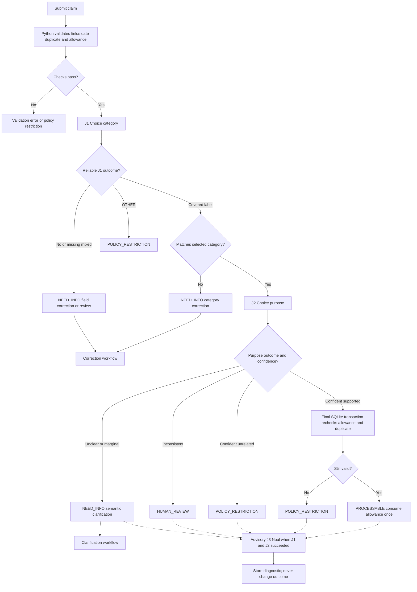
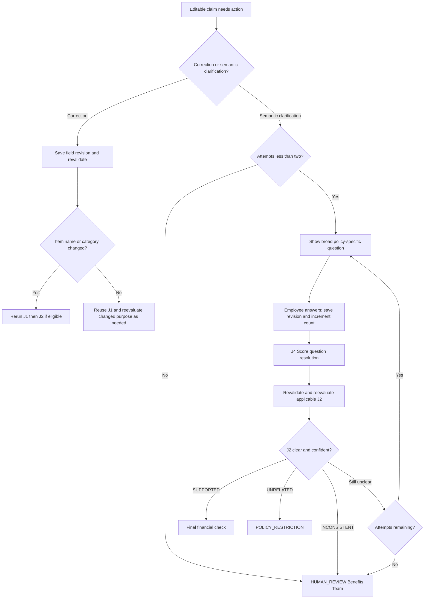
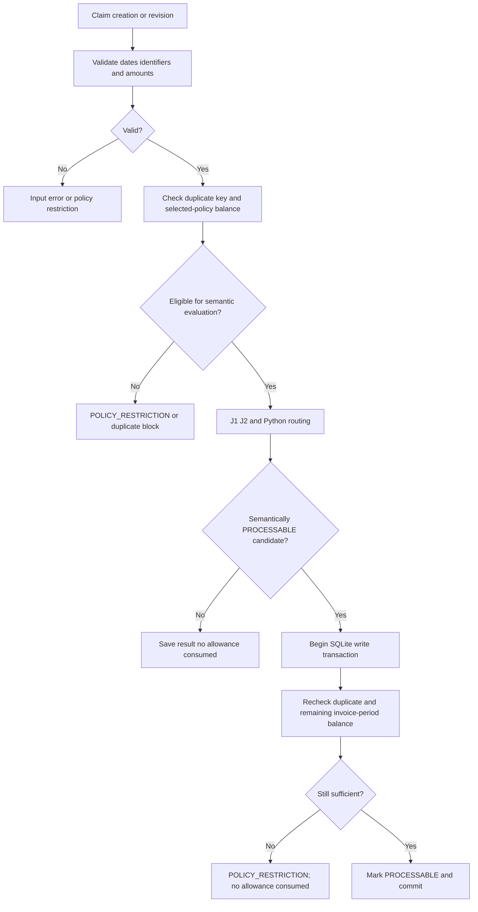

# Jev Expense Reimbursement — Consolidated Working Specification

**Status:** Implementation design consolidated on 2026-11-02. Agreed rules are marked **Finalized**; unresolved details are explicitly marked **Open**. This is the authoritative working specification for the local demo. The earlier complete working text is retained at the end for traceability.

## 1. Scope — Finalized

A local-only educational reimbursement decision demo. A developer clones the repository, supplies their own API key in a local `.env`, runs FastAPI, and uses a basic HTML/CSS/JavaScript page and SQLite database. Jev inference calls use the configured remote API. No deployment, Docker requirement, OCR, PDF ingestion, authentication, Benefits Team portal, payments, actual invoice verification, or fraud determination. The interface supports submission, result, corrections, purpose clarification, revisions, cancellation, audit history, and an expandable Decision Details panel.

Each claim is for **one specific invoice line/item**. Manually entered invoice details are unverified employee statements. J1/J2/J3/J4 judgments are semantic assessments, not proof of honesty or payment eligibility.

## 2. Input contract — Finalized

Required: `employee_id`, `merchant_name`, `invoice_number`, `invoice_date`, `invoice_item_name`, `invoice_item_amount`, `reimbursement_category`, `requested_reimbursement`, `employee_justification`.

Optional: `invoice_line_number` (default `1`). The system generates `claim_id`, initial `submitted_at`, revision IDs/timestamps, and evaluation history. Use **Invoice Item Name**, not a generic free-form Invoice Description. An item name is nevertheless manually typed, so it is not independently verified.

All money is INR, positive, represented with Python `Decimal` and a maximum of two decimal places. `requested_reimbursement <= invoice_item_amount`. Users may request less than cost; no auto-adjustment of requested amount.

### Invoice date

On first submission, invoice date must be no later than the **initial submission date**, and no earlier than **three calendar months** before it, inclusive (not 90 days). Use the application’s chosen local business date consistently (India/Asia-Kolkata by default for this project; a clock should be injectable in tests). Example: submission 2026-10-31 accepts 2026-07-31, rejects 2026-07-30 and 2026-11-01. Revisions of a timely filed claim can occur after the three-month window, but **any corrected invoice date is always rechecked against the original submission date** (including the future-date bound). Preserve both the old and new dates. A date correction is not automatically proof of fraud.

## 3. Fictional reimbursement policies — Prior agreed rules, fully expanded

| Category | Allowance period and cap | Qualifying semantic scope |
|---|---|---|
| `WELLNESS` | ₹30,000 per employee, invoice calendar year | Employee's own personal fitness/wellbeing: running shoes, gym apparel/equipment, fitness wearables such as Garmin, headphones/AirPods for workouts, gyms/trainers, nonmedical meditation subscriptions. Broad audio products can be candidates based on invoice name, while **purpose** is assessed by J2. Excludes personal entertainment, fashion, and explicitly another person's use. Short clear explanation like “for daily running” is enough; “personal use” alone may be unclear. |
| `SMARTPHONE` | ₹100,000 per employee, invoice calendar year | Smartphone **handset**, for employee's own use; no work-use requirement. Tablets, watches, accessories, and services excluded. |
| `BROADBAND` | ₹3,000 per employee, invoice calendar month | Fixed home broadband/fiber connectivity; no requirement to prove working from home. Mobile hotspot/mobile-data products excluded. |
| `MOBILE_BILL` | ₹750 per employee, invoice calendar month | Prepaid/postpaid cellular voice/data. Complimentary bundled streaming does not itself disqualify the plan. **Separately charged streaming/entertainment extras are excluded**; do not reimburse those components. |
| `BUSINESS_HOTEL` | No fixed cap | Work-related overnight stays for client work, company internal training/offsites/workshops, etc. Explanation of the legitimate work purpose is enough; do not demand external proof. Location alone does not establish purpose. |
| `BUSINESS_TRANSPORT` | No fixed cap | Work-related journeys for client visits, client transport, internal training/offsites, or specific exceptional travel to the regular office required by a business event. **Ordinary daily home-to-regular-office commuting is excluded**. Merely going with colleagues or attending an unspecified event is insufficient. |

Categorization and purpose are deliberately distinct. A device can belong to a candidate category yet be used for an excluded purpose. A bundled/multi-line purchase must identify the particular claimed item and its actual cost; the system must not invent price allocation. The absence of original invoice inspection limits verification of mobile-plan components. Python enforces any *explicitly structured* exclusion/amount arithmetic where supported, and J2 assesses the semantic description; do not suggest the application has verified an underlying bill.

## 4. Invoice-line identity and claim lifecycle — Finalized

Candidate duplicate key (scoped to employee): `(normalized_employee_id, normalized_merchant_name, normalized_invoice_number, invoice_line_number)`. Normalize case and incidental whitespace, but do not attempt unsupported fuzzy merchant identity. **An active or `PROCESSABLE` claim blocks a new claim on that line**. A `POLICY_RESTRICTION` or cancelled claim releases the key for a new initial submission, which must pass the three-month rule again. A processed line is never claimable a second time, even for the unpaid remainder. Revisions of the same claim ID do not self-conflict. Multiple different invoice lines under the same invoice are allowed.

- `NEED_INFO` and `HUMAN_REVIEW` claims can be cancelled, releasing the duplicate key; preserve history.
- `PROCESSABLE` is locked, cannot be cancelled/edited/reversed in V1.
- All pre-processing field corrections under the same claim ID are audited and revalidated. Invoice item name or category changes cause J1 to rerun. Justification-only revisions can reuse the prior J1 result. J2 reevaluates changed justification/category when it is reached.
- Rejected claims remain in history. A fresh submission is permitted on the same line if not already processed and all fresh validation passes; resubmitting an excluded item does not make it eligible.
- A `HUMAN_REVIEW` status does not indicate that an actual human has processed the claim; show the Benefits Team referral message instead.

## 5. Python financial validation and allowance consumption — Finalized

1. **Before Jev:** check required inputs, positive two-decimal amounts, requested <= line price, initial-submission-based invoice eligibility, duplicate claim key, selected-policy cap and already consumed amount. When requested > remaining allowance, assign `POLICY_RESTRICTION` with a precise amount message; **do not** silently reduce it or call this semantic `NEED_INFO`. No limit check on uncapped business policies.
2. Only `PROCESSABLE` consumes allowance. `NEED_INFO`, `HUMAN_REVIEW`, cancelled, and `POLICY_RESTRICTION` consume/reserve zero. Annual/monthly allowance periods are keyed by **invoice date**, employee and policy.
3. **At final processing:** start a serialized SQLite write transaction, recheck the duplicate key and remaining applicable allowance, then atomically record `PROCESSABLE` and the consumed requested amount. If capacity has disappeared, use `POLICY_RESTRICTION`; avoid double count on retries. For V1, derive consumed balance as sum of `PROCESSABLE` claims instead of maintaining a second mutable balance column.
4. Financial checks are deterministic; none of the Jev questions perform arithmetic or authorize payment.

## 6. Jev questions — Finalized responsibilities

### J1 — Choice: invoice-item category

Input: invoice item name and category definitions; **not** the employee's justification as category evidence. Outputs six covered categories plus `OTHER`, `INSUFFICIENT_INFORMATION`, `MIXED_ITEMS`, and full Choice distribution/confidence. Evaluate before J2.

- Apply Choice confidence/margin checks before acting on its selected category. If uncertain, `NEED_INFO` requesting a more precise item name; one ordinary correction opportunity, then `HUMAN_REVIEW` if still unresolved (no semantic clarification attempt used).
- Confident covered category but different employee selection: `NEED_INFO` requesting category correction **before J2**. Do not change it silently; rerun J1 after correction. Ordinary field corrections do not count as semantic clarification attempts.
- Confident `OTHER`: `POLICY_RESTRICTION`; **skip J2**.
- `INSUFFICIENT_INFORMATION`: ask for a specific item; `MIXED_ITEMS`: ask for exactly one item and its line amount, then rerun J1; unresolved inseparable bundle → `HUMAN_REVIEW`. Skip J2 until valid.

### J2 — Choice: purpose alignment

Runs after J1 establishes a sufficiently reliable, employee-matching covered category. Use original invoice item name, accepted category, employee justification, and matching policy. Labels: `SUPPORTED`, `UNRELATED`, `UNCLEAR`, `INCONSISTENT`. Do not use financial balance or other Jev judgments as evidence.

- `SUPPORTED`: if confidence/margin pass, can proceed to final Python financial transaction; if not, `NEED_INFO`.
- `UNRELATED`: if confidence/margin pass, `POLICY_RESTRICTION`; if not, `NEED_INFO` (same uncertainty treatment as SUPPORTED).
- `UNCLEAR`: `NEED_INFO` with broad policy-specific question.
- Confident `INCONSISTENT`: `HUMAN_REVIEW` with Benefits Team referral; do not accuse of deception. Low-confidence exceptional routing is **Open** (see §11), but never auto-process.

### Confidence/margin — Experimental default configuration

Use `JEV_MIN_CONFIDENCE=0.70`, `JEV_MIN_PROBABILITY_MARGIN=0.30` from environment/backend settings, not hardcoded in each branch. Margin = highest Choice label probability minus second-highest. **Both** checks are used, and confidence is **not** interchangeable with winning-label probability. Treat defaults as provisional, not proven calibrated thresholds. Preserve complete distributions, chosen label, reported confidence, model version, and question revision in decision history. If the SDK response lacks required fields or is malformed, fail safely (see errors).

### J4 — Score: clarification-resolution assessment

Only on employee responses to an **outstanding semantic clarification question**; compare original relevant evidence, exact category-specific question, and revised explanation. Rubric: `0` no relevant resolution, `1` partial resolution, `2` fully answered. Score is fractional in [0,2], with rubric-level probabilities and a separate confidence. A fully answered question may reveal an **excluded** purpose: high Score is **not approval**.

After the revision, revalidate Python rules and reevaluate relevant J1/J2 as necessary **regardless of J4 Score**. A confident J2 outcome takes precedence. If J2 remains uncertain, J4 can help determine whether another clarification would be useful; this supporting role is agreed, but the exact numeric J4-to-routing cutoff is **Open**. At most **two semantic clarification responses**; after the second unresolved evaluation, `HUMAN_REVIEW` with Benefits Team referral. Ordinary corrections and technical retries don't consume those attempts.

### J3 — Noul: advisory-only semantic comparison

After Python determines a claim outcome, when J1 and J2 completed successfully, run one Noul proposition about whether **the original claim evidence affirmatively supports the qualifying semantic requirements of the selected policy**. Supply claim evidence and policy, **not the conclusions of J1/J2/J4**. Record probability for developer comparison, but do **not** call it a likelihood that the final decision is correct. It cannot approve, deny, clarify, consume allowance, or change status. A J3 failure is `UNAVAILABLE` and has no effect on the decided claim. Prior narrow Noul tests (exceptional commute, charged mobile extras) stay in `experiments/` and **are not V1 calls**.

**Ordering note:** J3 is diagnostic *after* the Python decision. The UI should not present the decision as waiting for advisory Noul. If synchronous evaluation runs J3 before returning HTTP response for simplicity, a timeout must still never turn a processable decision into review.

## 7. Clarification and error handling — Finalized

One **broad, predefined question per category**, mapped directly from category in Python. No separate Choice call to select clarification type and no free-text generation. Deterministic input errors have precise messages. Example Business Transport: “Please explain the business purpose of your journey and why the travel was necessary.” Wellness: “Please explain how this purchase supports your personal fitness or wellbeing.” No mandatory essay or external verification.

A semantic `NEED_INFO` creates an outstanding question. Each submitted response increments the semantic clarification count **once**. If still uncertain and the count <2, ask again. After count 2 with unresolved semantic interpretation, route to `HUMAN_REVIEW` with “Please get in touch with the Benefits Team.” The `NEED_INFO` status for item name/category/mixed-line correction is distinguished internally by a **reason code** so that field correction does not consume semantic attempts.

Decision-critical Jev timeout, invalid/missing response, or provider error → `HUMAN_REVIEW` with a technical-failure reason, no allowance consumption; users may **retry same claim ID**, with each attempt recorded and no clarification-count increment. J3 advisory errors do not affect claim status. No secrets in audit logs. A hypothetical payment is never made by this demo.

## 8. Status transitions and persistence — Consolidated

| Current state | Trigger | Next state / behavior |
|---|---|---|
| New submission | Deterministic validation failure | Input error or `POLICY_RESTRICTION` as applicable; persist policy restriction/history |
| New or editable claim | J1 uncertain / missing / mixed / category mismatch | `NEED_INFO` (reason `FIELD_CORRECTION`); rerun J1 on updated item/category |
| Valid category | J2 uncertain or UNCLEAR | `NEED_INFO` (reason `SEMANTIC_CLARIFICATION`); ask broad template |
| Valid category | Confident J2 UNRELATED | `POLICY_RESTRICTION` |
| Valid category | Confident J2 INCONSISTENT | `HUMAN_REVIEW` |
| Valid category | Confident J2 SUPPORTED + final transaction valid | `PROCESSABLE` and consume allowance once |
| Semantic NEED_INFO | Clarification submitted | Increment attempts, run J4, reevaluate J2, route fresh outcome |
| Semantic NEED_INFO | Second response still unresolved | `HUMAN_REVIEW`; Benefits Team message |
| Critical Jev failure | Any critical call | `HUMAN_REVIEW` (reason `TECHNICAL_FAILURE`); allow same-claim retry |
| NEED_INFO / HUMAN_REVIEW | Cancellation | `CANCELLED`; release key; no allowance consumed |
| POLICY_RESTRICTION / CANCELLED | New claim | New claim ID, validate invoice age afresh, preserve old history |
| PROCESSABLE | Edits/cancellation/new claim on same line | Disallow in V1 |

Suggested *minimal* SQLite data: `claims` (identity/current status/original submitted timestamp/clarification count), `claim_revisions` (full submitted input snapshot, revision reason and timestamp), `evaluations` (question type, evidence/input version, model version, label, full distribution, confidence/score/Noul probability, failure metadata), `status_events` (from/to, reason, timestamp). Exact schema and indexes can be selected by Codex while maintaining unique active/processed invoice-line behavior, transactionality, and auditability. Do not store API keys.

## 9. Local UI and reproducibility

One basic claim form, a claims/history view, and an expandable developer decision panel. Support changing pre-processable invoice fields, entering clarification answers, and retrying technical failures. Show status and plain-language reason, not a fraud accusation or a “paid” claim. Developer panel shows full Jev distributions/confidence and J4 rubric probabilities and optional J3 diagnostic probability. Examples in README should include correct Wellness running use, unrelated gift/movie purpose, wrong category Garmin, unclassified iPad, vague business journey, exceptional client meeting, mobile complimentary vs charged streaming, partially answered clarification, invalid old invoice, insufficient balance, and duplicate line. README says results may vary with model versions; each developer supplies their own API key and all UI/SQLite run locally.

Preserve historical J1/J2/J3/J4 experiments and pre-registered fixtures as evidence; do not overwrite experimental data or falsely label Noul as an accuracy probability.

## 10. Flowcharts — Working architectural diagrams

### Main claim evaluation

### Revision and clarification

### Financial integrity

## 11. Explicit open implementation points (not newly agreed policy)

1. **J4 routing (resolved 2026-11-03):** J4 Score is informational only; its score, distribution and confidence appear in Decision Details with a disclaimer. It never controls status, acceptance, rejection or escalation. Revised claims are reassessed by J2 and Python, with the existing two-attempt rule. No J4 routing threshold.
2. **J1 input/category policy wording:** J1 should classify from the item name and candidate-policy definitions, ignoring employee purpose; rerun if category changes per earlier agreement. The category-change-triggered rerun may produce the same item classification; do not force a different result.
3. **Uncertain `INCONSISTENT` behavior (resolved 2026-11-03):** Apply the same configured Choice confidence and top-two margin requirements used for SUPPORTED/UNRELATED. If both pass: `HUMAN_REVIEW`; if either fails: `NEED_INFO` with category clarification, subject to the existing two semantic clarification attempts, after which `HUMAN_REVIEW`. Never describe the judgment as fraud.
4. **Invoice line identity limits:** default line number `1` may lead to collisions if employees omit it for different items on one invoice; UI should encourage entering actual line number for multi-line invoices. Normalized text is not independent proof of invoice uniqueness.
5. **Potential mismatch in previous flowchart:** the earlier drawing included advisory J3 following a final financial failure, but only when both J1/J2 actually completed. This version makes the precondition explicit.
6. **Manual component billing:** separately charged mobile entertainment must not be reimbursed; with only an item-name field, precise itemization and per-component amounts may be unavailable. If it cannot be determined, request one eligible item/amount or refer to Benefits Team rather than pretending Python verified the bill.

---

## Archived prior working specification (verbatim; retained so no settled detail is lost)

The following is the complete text that existed before this consolidation. The consolidated sections above govern when historical wording is outdated, while the archive preserves decision provenance.

# Jev Expense Reimbursement — Working Design Specification

Status: living draft. Updated 2026-11-02. Decisions marked **Finalized** are agreed; **Proposed** items require discussion.

## Project boundaries — Finalized
- Local-only developer demo: clone repository, configure own API key, run FastAPI and basic local HTML/JS UI with SQLite. Remote Jev inference uses developer-provided key. No hosting, OCR, invoice PDF ingestion, authentication, Docker requirement, or Benefits Team integration.
- One claim covers one specific manually entered invoice item/service. Several distinct claims may share an invoice.
- UI shows result, actionable clarification when needed, revision history and optional developer decision details. Unresolved uncertainty directs employee to Benefits Team.
- J1 Choice: product/service category. J2 Choice: purpose alignment. J3 Noul: advisory-only semantic cross-check after decision-critical J1/J2; never influences routing. J4 Score: degree to which revision answers clarification (experimental results encouraging). Python owns validation, financial arithmetic and routing. Model confidence and distributions are preserved and evaluated; initial experimental confidence >= 0.70 and margin >= 0.30.

## Submission fields — Finalized
1. **Employee ID** (required; manually entered, no authentication or registration; identifies separate local claim and allowance histories)
2. **Merchant Name** (required; manually entered)
3. Invoice number (required)
4. Invoice date (required)
5. Invoice line number (optional; default 1; used for invoice-line identity and duplicate prevention)
6. **Invoice Item Name** (required, rather than free-form `description`; user-entered representation of invoice name, not independently verified)
7. Invoice Item Amount in INR (required)
8. Reimbursement Category (required, selected by employee)
9. Requested Reimbursement in INR (required)
10. Employee Justification (required)
System generates claim ID; revisions retain claim ID and audit history. It does not silently change selected category.

## Invoice age validation — Finalized
- At initial submission, invoice date must not be in the future and must be no older than **three calendar months** from submission's local current date, inclusive; not a fixed 90-day approximation.
- E.g. on 2026-10-31, 2026-07-31 is eligible, 2026-07-30 is too old; 2026-11-01 is future-dated.
- Invalid date is rejected before Jev inference.
- Annual/monthly allowance attribution uses the invoice's calendar year/month, not the submission date.
- **Revision-age rule — Finalized:** validate the three-month age limit only at the initial submission. Timely submitted claims may be revised after the invoice passes the three-month cutoff, retaining the same claim ID. Future dates and other field checks still apply to submitted revisions; do not create a new claim to bypass the date rule.

## Amount and duplicate-claim rules — Finalized (2026-10-31)
- Invoice item amount and requested reimbursement are positive INR Decimal quantities, maximum two decimal places.
- Requested reimbursement must not exceed the invoice item amount. An employee may request less, and Python must not automatically raise the requested amount.
- Python enforces the remaining allowance for the applicable policy period. **Finalized Step 9:** if the requested reimbursement exceeds the remaining allowance, reject that claim as `POLICY_RESTRICTION` with the requested amount and remaining balance in the explanation; do not return `NEED_INFO` merely to request amount correction and do not silently reduce the amount. Business Hotel/Business Transport have no fixed allowance cap. If a claim is rejected specifically because its requested reimbursement exceeds remaining allowance, the employee may submit a **new claim** for the same invoice line at a lower requested amount, provided the new claim meets the three-calendar-month invoice-age limit at its own initial submission. The original rejected claim stays in history and consumes no allowance. This rejection releases the duplicate key for a corrected new claim. **Finalized Step 11:** a `POLICY_RESTRICTION` for any policy reason likewise releases the duplicate key and permits a new claim for the same invoice line, provided all new-submission validations (including invoice age) pass. Rejected claims remain in history and consume no allowance. An ineligible purchase does not become eligible merely by resubmission.
- One invoice line may be reimbursed only once: after a line has been processed, a second claim on that same line (even for an unused remainder of the price) is not accepted.
- A claim can be revised under the same claim ID before processing; revisions are not independent new reimbursements and must not double-count allowance.
- **Merchant-name identity — Finalized:** merchant name is required to distinguish invoice numbers issued by different merchants. For the local demo, use employee ID + normalized merchant name + normalized invoice number + invoice line number as the candidate duplicate key. Manually typed merchant names can vary; this is not independently verified identity and is not fraud detection.
- **Pending duplicate claims — Finalized:** while an active claim exists for the same employee + normalized merchant + invoice + line key, block creating another claim for that line; direct the employee to revise the existing claim. Processed lines remain blocked. Cancelled claims release the key; **all policy-rejected claims also release the key for a new submission**. New submissions must satisfy the invoice-age rule.

## Allowance consumption — Finalized (2026-10-31)
- Only a claim reaching `PROCESSABLE` consumes its requested reimbursement amount from the applicable policy period. `NEED_INFO`, `HUMAN_REVIEW`, and `POLICY_RESTRICTION` do not consume or reserve any allowance.
- `PROCESSABLE` means eligible for processing in this demo, not actual payment approval.
- Processing/retries/revisions must not double-deduct; enforce the balance check and recording of consumption atomically in SQLite to avoid competing claims overdrawing a balance.
- Reversal of a processed claim is outside V1.

## Employee identity — Finalized (2026-10-31)
- Require an Employee ID on claims. Each employee ID has its own allowance balances and claim history. No signup, passwords or authentication; this is a local learning demo.
- Duplicate checks are scoped to the same Employee ID; separate employees are not automatically flagged as duplicates solely because their merchant/invoice/line key matches.

## Revision editing — Finalized (Step 12, 2026-10-31)
- Before a claim reaches `PROCESSABLE`, employees may correct invoice details (including invoice number), while retaining its claim ID.
- Every edit creates an auditable revision; Python reruns validation and duplicate checks against the revised identity/values, excluding the current claim's own ID from the duplicate comparison.
- Once `PROCESSABLE`, invoice details are locked; no V1 editing/reversal of processed claims.
## Invoice-date corrections — Finalized (Step 13, 2026-10-31)
- If a revision changes the invoice date, validate that corrected date against the claim's **original submission date**, not the revision date.
- If the corrected date was older than three calendar months at original submission, or was future-dated then, it fails eligibility validation and routes to `POLICY_RESTRICTION`.
- Preserve original and corrected dates in the audit history. A discrepancy is not automatically fraud; manual invoice data cannot establish intent or authenticity. Material indications of misrepresentation may be flagged for Benefits Team review without making an accusation.

## Jev API errors and retries — Finalized (Step 14, 2026-10-31)
- Timeouts, malformed responses, and API failures must **never** lead to `PROCESSABLE` or allowance consumption.
- Record the claim as `HUMAN_REVIEW` with a technical evaluation failure reason; show a friendly message advising the employee to contact the Benefits Team.
- Permit the employee to **retry evaluation on the same claim ID** after a technical error; record each attempt and outcome in audit history and preserve safe failure diagnostics without storing or exposing API keys.
- Do not deduct allowance on failed attempts; protect against duplicate consumption if a subsequent retry succeeds.

## Clarification lifecycle — Finalized (Step 15, 2026-10-31)
- Allow at most **two semantic clarification responses** per claim. Each response to an explicit outstanding clarification counts as one attempt, and is auditable.
- After each clarification response, J4 Score evaluates how completely the response addresses the specific question, and relevant semantic decisions are re-evaluated on the revised claim. A sufficiently answered question never by itself means reimbursement eligibility.
- If semantic uncertainty remains unresolved after two clarification responses, route to `HUMAN_REVIEW` and direct the employee to the Benefits Team.
- Technical retries for Jev failures and ordinary edits/corrections not submitted as answers to an outstanding semantic question do **not** count as clarification attempts.
- Do not treat a high Score as authorization to process or a low Score as evidence of dishonest intent.

## Next work
- Settle remaining claim-routing and lifecycle decisions one at a time; then draw three flowcharts and prepare the Codex implementation specification.

## Preliminary policies (from prior design, for later confirmation)
- Wellness: INR 30,000 / calendar year.
- Smartphone handset: INR 100,000 / calendar year.
- Fixed home broadband: INR 3,000 / month.
- Cellular mobile bill: INR 750 / month, excluding separately charged entertainment extras.
- Business hotel and qualifying business transport: no fixed caps; ordinary home-to-regular-office commute excluded except specific qualifying business exceptions.

This spec records agreements from the design discussion; it is **not yet synchronized to the GitHub repository**.

## Semantic workflow decisions — Steps 16–25 (finalized)
- **Step 16 — Clarification questions:** Use one broad, predefined clarification template per reimbursement category, chosen by Python. No extra Jev call. Deterministic validation errors get direct messages.
- **Steps 17–19 — Choice uncertainty:** Inspect both Jev reported confidence and difference between two leading Choice probabilities. Experimental defaults: confidence >= 0.70 and margin >= 0.30; not calibrated. Low-confidence/marginal SUPPORTED or UNRELATED => NEED_INFO; if uncertainty persists after two clarification responses, HUMAN_REVIEW. Preserve distributions and confidence.
- **Steps 20–23 — J3 Noul:** One advisory-only semantic-support proposition given claim evidence and policy, not earlier model outputs. Run after Python decides, where J1 and J2 complete successfully, regardless of status. Never change outcome; failure recorded UNAVAILABLE only. Previous narrow commute/mobile Noul tests remain in experiments, not application V1.
- **Step 24 — J4 Score:** On clarification revisions, evaluate completeness of the response to the exact question. Rerun relevant J2/policy decisions regardless. J2 and Python control all routing, including when unresolved; Score is displayed for educational/diagnostic purposes and never independently influences approval, rejection, clarification or escalation.
- **Step 25 — J1 revision policy:** Rerun J1 when Invoice Item Name or selected Category changes; reuse J1 if only justification changes. J2 reassesses revised justification; retain audit history.

## Step 26 — Category correction ordering (finalized, 2026-11-02)
- J1 checks invoice item category first. On reliable mismatch with employee-selected category, pause and ask correction **before J2**. Correction under same claim ID, rerun J1, then J2 if category matches; ordinary category correction doesn't consume a semantic clarification attempt. If J1 itself uncertain, use uncertainty routing rather than claim definitive mismatch.

## Step 27 — Uncertain J1 classification (finalized, 2026-11-02)
- If J1's selected category fails the agreed provisional confidence or probability-margin checks, do **not** proceed to J2 or assert a definitive category mismatch.
- Return `NEED_INFO` requesting a more specific **Invoice Item Name**; the correction is an ordinary field edit and does **not** count against the two semantic-purpose clarification attempts.
- Rerun J1 after the item name is corrected. If classification is still unresolved, send the claim to `HUMAN_REVIEW` with Benefits Team guidance, rather than looping indefinitely.
- Keep original and corrected item names, J1 confidence and complete distributions in the audit history.

## Step 28 — J1 returns OTHER (finalized, 2026-11-02)
- When J1 confidently returns `OTHER`, the item does not fit any covered category: route to `POLICY_RESTRICTION` without calling J2.
- Explain to the employee that the item is not covered by the reimbursement policies; preserve the claim and decision in history.
- This differs from a mismatch with another *covered* category, which is correctable before J2.
- Existing decisions on resubmitting rejected claims and on confidence-aware handling still apply.

## Document maintenance
- This filename is the single authoritative working specification in this conversation. Update this file in place at decision checkpoints rather than creating V2/V3/V4 copies. Earlier versions are superseded.

## Step 29 — J1 returns INSUFFICIENT_INFORMATION or MIXED_ITEMS (finalized, 2026-11-02)
- `INSUFFICIENT_INFORMATION`: return `NEED_INFO` asking for a more specific **Invoice Item Name**; do not call J2 yet.
- `MIXED_ITEMS`: return `NEED_INFO` asking the employee to identify the single claimed invoice item and its actual corresponding amount; do not call J2 yet.
- Corrections stay under the same claim ID, preserve audit history, rerun J1, and do not use either of the two semantic-purpose clarification attempts.
- If the invoice contains a genuinely inseparable bundle or its component price cannot be established, do not invent or prorate amounts: route unresolved cases to `HUMAN_REVIEW` with Benefits Team guidance.
- Apply the existing J1 confidence/uncertainty policy before treating these classifications as definitive.

## Step 30 — J2 INCONSISTENT (finalized, 2026-11-02)
- `INCONSISTENT` denotes a potentially qualifying stated purpose materially at odds with the purchased item/service. It is distinct from `UNRELATED`, where the stated purpose itself is explicitly excluded.
- Following J1 category validation, route a confident J2 `INCONSISTENT` result to `HUMAN_REVIEW` with Benefits Team guidance, not a fraud accusation or automatic policy denial.
- Preserve the submitted evidence and Jev response in audit history. Handle uncertain J2 results under the existing confidence-aware routing principles; do not treat model judgments as proof of dishonesty.

## Step 31 — J2 UNCLEAR (finalized, 2026-11-02)
- Route J2 `UNCLEAR` to `NEED_INFO`, using the broad category-specific clarification template.
- Allow at most two semantic clarification responses; if still unresolved, route to `HUMAN_REVIEW` with Benefits Team guidance.

## Step 32 — J2 SUPPORTED and configurable uncertainty thresholds (finalized, 2026-11-02)
- J2 `SUPPORTED` proceeds only when reported Choice confidence and top-two probability margin pass the configured safeguards; otherwise route to `NEED_INFO`, subject to the agreed two-attempt limit.
- Initial experimental defaults: `JEV_MIN_CONFIDENCE=0.70` and `JEV_MIN_PROBABILITY_MARGIN=0.30`; read from local backend environment/configuration, not hardcoded throughout routing. Values are provisional and not calibrated.
- If semantic checks and deterministic financial validations pass, set `PROCESSABLE` and atomically consume the applicable allowance, with no double deduction on revision/retry.
- Advisory J3 Noul runs after the Python outcome if decision-critical J1 and J2 completed successfully; store/display its semantic-support probability without changing the decision. J3 failure remains `UNAVAILABLE` and has no effect on status.

## Step 37 — J4 advisory interpretation (finalized, 2026-11-03)
- J4 Score is informational/diagnostic in V1. Show score, distribution and confidence in Decision Details with disclaimer: “This score indicates how completely the clarification question was answered; it does not determine reimbursement eligibility or the final decision.”
- Always reevaluate revised justification using J2/Python. No J4 numerical routing threshold or automatic status impact.

## Step 38 — Confidence-aware J2 INCONSISTENT (finalized, 2026-11-03)
- Apply configured minimum confidence (initial 0.70) and top-two probability margin (initial 0.30) to INCONSISTENT as with SUPPORTED and UNRELATED.
- Both pass: HUMAN_REVIEW and Benefits Team guidance. Either fails: NEED_INFO and broad policy clarification; after two semantic clarification attempts, HUMAN_REVIEW.
- This is evidence of possible item-purpose mismatch, not evidence or accusation of fraud.

## Step 39 — Separately charged mobile-bill components (finalized, 2026-11-03)
- If the manually entered Invoice Item Name indicates a mobile plan plus a separately charged entertainment/streaming add-on (for example, INR 699 cellular service + INR 199 Netflix add-on), do **not** treat the combined invoice amount as eligible merely because the requested amount falls under the INR 750 monthly mobile allowance.
- Return `NEED_INFO` for an **ordinary invoice-item correction**: ask the employee to specify only the eligible cellular-plan item and its actual separate charge, and adjust the requested reimbursement to no more than that eligible item cost. Preserve the correction under the same claim ID and audit history; it does **not** consume one of the two semantic-justification clarification attempts.
- After editing, rerun deterministic validation and J1/J2 as dictated by the revised fields; do not silently split or infer component prices. If an itemized eligible charge cannot be established, route to `HUMAN_REVIEW` with Benefits Team guidance.
- Complimentary streaming bundled at no additional charge does not itself disqualify the underlying mobile plan. The actual invoice is **not uploaded or verified** in V1; screening uses employee-entered information and is not proof of invoice authenticity or amount.
